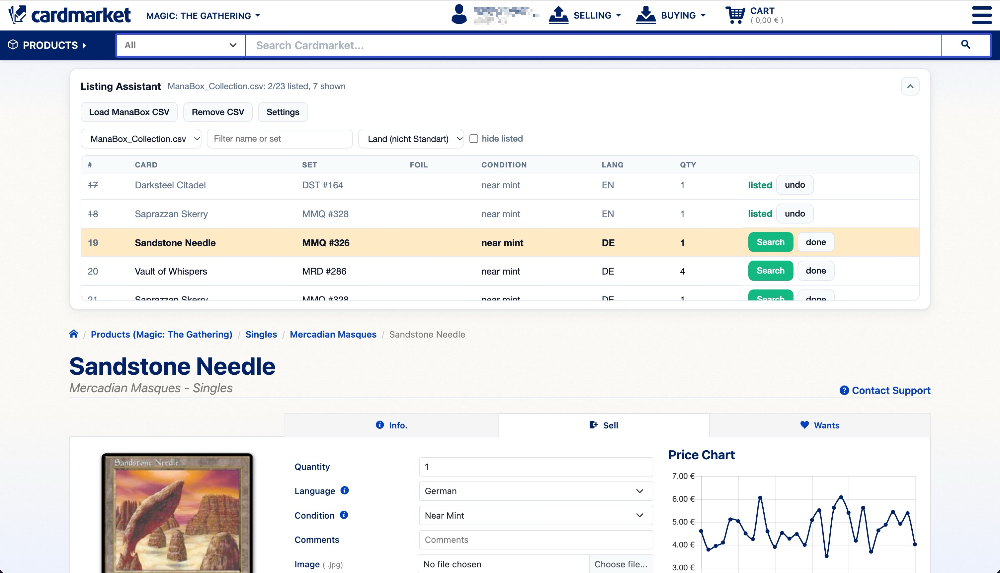
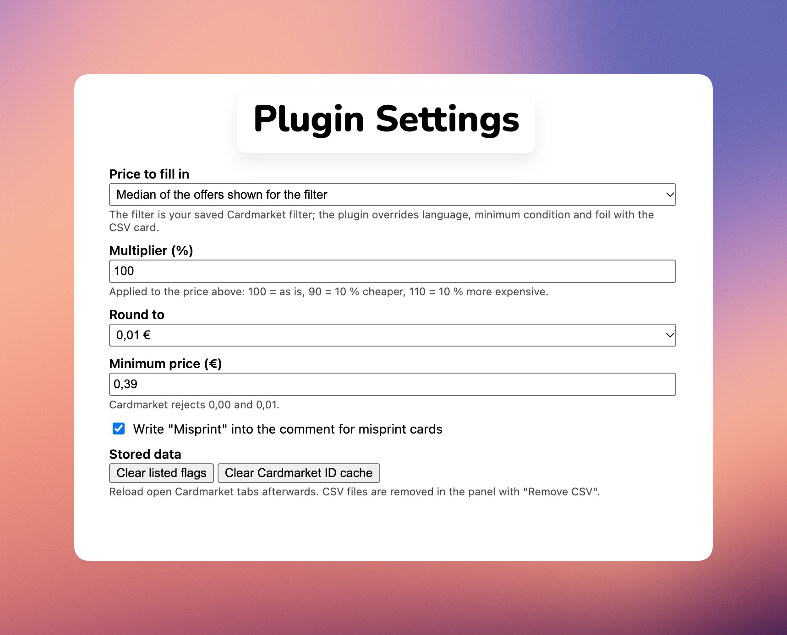

# Listing Assistant for Cardmarket

Browser extension (Manifest V3, plain JavaScript, Firefox and Chromium) that helps to list cards from a ManaBox CSV on Cardmarket, one card at a time.

1. Load one or more ManaBox CSV exports (list or collection) in the panel under the top search bar of any Cardmarket Magic page.
2. Click **Search** on a card. The plugin opens its product page, filtered to the card's language, condition (as minimum) and foil state; your other saved Cardmarket filters stay as they are.
3. The plugin fills the Sell tab (quantity, language, condition, foil, signed, altered, comment) and a price, by default the median of the offers shown for that filter.
4. You check the offers and press "Put for sale" yourself. The plugin never submits anything.
5. The row is marked as listed when Cardmarket confirms the listing. Every loaded CSV keeps its own listed flags.

Cards are identified by the Scryfall ID in the ManaBox CSV, which Scryfall maps to the Cardmarket product ID, so there is no name matching.

## Install for development

- Chrome and other Chromium browsers: `chrome://extensions` (Brave: `brave://extensions`, Edge: `edge://extensions`), enable developer mode, "Load unpacked", pick this folder. Tested in Chromium only.
- Firefox: `about:debugging`, "This Firefox", "Load Temporary Add-on", pick `manifest.json`.

Tests: `node --test test/shared.test.mjs test/labels.test.mjs test/labels-static.test.mjs`.

## Features

- **Panel under the search bar** on every Magic page on Cardmarket; collapsible, remembers its state.
- **Several ManaBox CSVs**, list or collection exports, each kept separately with a file selector; a binder selector for collection exports.
- **Drag and drop** CSV files onto the panel (the panel fades and shows a hint; other file types are refused), or use "Load ManaBox CSV".
- **Sortable table**: click a column header to sort ascending, descending, or back to CSV order. The `#` column sorts by scanned order (ManaBox's `Added` time).
- **Exact card match** through the Scryfall ID in the CSV (Scryfall gives the Cardmarket product ID); cached.
- **Search button** opens the product page filtered to the card's language, minimum condition and foil state, on top of your saved Cardmarket filter.
- **Sell form pre-filled**: quantity, language, condition, foil, signed, altered, comment ("Misprint" optional) and price.
- **Price from the live market**: median or lowest of the offers shown for that filter, or none; multiplier, rounding and minimum price in the settings.
- **Click an offer price** in the offers table to copy it into the sell form's price field.
- **Filter changes keep your form**: the Cardmarket filter button reloads the page, the plugin puts the sell form values back (an auto-filled price is recomputed for the new filter, a price you entered is kept).
- **Condition and language follow the filter**: changing them in the sell form applies them to the offers filter. The page scrolls to the card title after a search or filter reload.
- **Stay logged in (optional, off by default)**: Cardmarket logs you out after 1 hour without activity. When enabled in the settings, an open Cardmarket tab loads one Cardmarket page every 30 minutes while you are logged in. No password is stored.
- **Listed tracking per loaded CSV**, marks a card "listed" after Cardmarket's success message; manual "done" and "undo" per row.
- **Nothing is submitted for you** and nothing leaves the browser except Scryfall IDs sent to `api.scryfall.com`.

*Why Scryfall: the ManaBox CSV has no Cardmarket product ID, but every Scryfall card record includes it (`cardmarket_id`). The plugin sends only the Scryfall IDs from your CSV (up to 75 per request, once per card, then cached) and reads back the product ID.*

## Edition labels

The panel has an **Edition labels** button. It opens a page where you pick sets from the loaded CSV, search the Scryfall set list, or preselect sets with `labels.html#sets=ons,dom`. Each label can show the Keyrune set icon, the set name, the set code, a FOIL mark and a Cardmarket condition code (never a quantity). The preview is exact. Export a PNG for 24 mm tape (128 dots high, 180 dpi), one at a time or all as one ZIP.

### Printing

Verified on a Brother PT-P710BT with 24 mm tape in P-touch Editor (Mac). The editor ignores the PNG's 180 dpi tag and imports it far too small. Select the image, keep **Fix Aspect Ratio** on and type **Height = 18 mm** in the Layout panel; the width follows (about 100 mm for a long label). Set **Y** to 3 mm, leave **Set Length** off and use the smallest **Margin** you accept (the same tips are shown under the label cards). "Max label length (mm)" on the page limits the width; long names then break into lines and shrink to fit.

## Comparison with other tools

|                   | This plugin                                                                                                      | [cardmarket-bulk-import](https://github.com/PedroPerpetua/cardmarket-bulk-import) | [cardmarket-helper](https://github.com/SuppenNudel/cardmarket-helper)                                                                | [MtgCsvHelper](https://github.com/StepKie/MtgCsvHelper) |
| ----------------- | ---------------------------------------------------------------------------------------------------------------- | --------------------------------------------------------------------------------- | ------------------------------------------------------------------------------------------------------------------------------------ | ------------------------------------------------------- |
| Kind / browsers   | Extension: Chromium (tested), Firefox (manifest ready, untested)                                                 | Extension: Chrome and Firefox                                                     | Extension: Firefox                                                                                                                   | Web app (any modern browser) and .NET console app       |
| Purpose           | List cards one by one from a ManaBox CSV with the sell form pre-filled                                           | Fill Cardmarket's "Bulk List Cards" table from a CSV                              | Many helpers for Cardmarket (thumbnails, owned printings, sell-form fill from a stored ManaBox collection, wants/orders export, ...) | Convert collection CSVs between sites                   |
| Cardmarket page   | Magic product pages (Sell tab), panel on every Magic page                                                        | `Stock/ListingMethods/BulkListing`                                                | Product, offer, order and wants pages                                                                                                | none                                                    |
| Card matching     | Scryfall ID -> Cardmarket product ID (exact)                                                                     | Card name (fuzzy) and set via MTGJSON                                             | Scryfall ID / Cardmarket ID                                                                                                          | Scryfall ID, names, set codes                           |
| Price             | Median or lowest of the offers matching the card's language/condition/foil filter; multiplier, rounding, minimum | From the CSV price column                                                         | Price logic over low, trend and average prices plus top offers                                                                       | Not applicable                                          |
| Volume            | One card per click, you review each                                                                              | Up to 100 cards per import, Cardmarket shows at most 300 cards per filter         | One card per click                                                                                                                   | Whole files                                             |
| Listed tracking   | Per loaded CSV, set automatically after Cardmarket's confirmation                                                | none                                                                              | Uses ManaBox's "misprint" field as a manual marker                                                                                   | none                                                    |
| Multiple CSVs     | Yes                                                                                                              | One file per import                                                               | One stored collection                                                                                                                | Not applicable                                          |
| Automatic Submits | No                                                                                                               | No                                                                                | No                                                                                                                                   | Not applicable                                          |

Notes:

- cardmarket-bulk-import is faster when you list many cards of one expansion in a single batch. It matches by name, only sees the cards on the current page of the bulk table, and imports nothing for cards beyond the 300-card cap (for example high collector numbers such as lands).
- cardmarket-helper covers far more than listing; this plugin is intentionally small and separate. The helper's "Fill" works on the Singles page from a collection stored in the browser.
- MtgCsvHelper cannot produce anything Cardmarket accepts: its Cardmarket format is import only, and Cardmarket has no CSV upload for listings.
- The comparison reflects the READMEs and code of the other tools as read on 2026-10-16; check them for newer changes.

## Privacy

- **No telemetry, no analytics, no tracking, no accounts.** The plugin collects nothing about you.
- **The only external requests** go to `api.scryfall.com`: the Scryfall IDs of your CSV cards, to look up Cardmarket product IDs, and, when you open the Edition labels page, one `GET https://api.scryfall.com/sets` for the public set list (cached for 24 hours). Like any web request they expose your IP address to Scryfall. Nothing else is sent: not your prices, quantities, conditions, file names or Cardmarket account data.
- **Everything else stays in your browser**: the loaded CSVs, the ID cache, listed flags, settings and panel state live in the extension's local storage (`storage.local`, not synced to any account). The Cardmarket tab's `sessionStorage` holds a timestamp to detect a finished listing (no card data) and, for a few seconds around a filter reload, the sell form's values (quantity, language, condition, flags, comment, price); both are removed again and vanish with the tab.
- On Cardmarket the plugin only reads the page you have open and fills the form fields; the product pages it opens are normal page loads in your own tab. It never submits a listing for you. With the optional "Stay logged in" setting, an open tab also requests one Cardmarket page (`/<lang>/Magic`) every 30 minutes, the same as a reload; the response is discarded.
- The Edition labels page keeps its preferences and the cached public set list in its own `localStorage` (no CSV data, card names, quantities or prices). Set codes in the `#sets=` URL fragment are never sent to any server. PNG and ZIP files are made in the page and never uploaded.
- Delete data with "Remove CSV" in the panel, "Clear listed flags" and "Clear Cardmarket ID cache" on the options page, or by removing the extension.

## Contributing

- **Bug reports:** open a GitHub issue with the title prefix `[Bug]`, for example `[Bug] Price not filled for foil cards`.
- **Questions:** open a GitHub issue with the title prefix `[QA]`.
- **Feature requests:** open a GitHub issue with the title prefix `[Feature]`, for example `[Feature] Remember the last used binder`.
- **Fixes:** pull requests that fix a bug are welcome. Run `node --test test/shared.test.mjs test/labels.test.mjs test/labels-static.test.mjs` before you open one.
- **New features:** please discuss them in a `[Feature]` issue first. A pull request for a feature that was not agreed in an issue may be closed.

## License and disclaimer

MIT, see [LICENSE](LICENSE). Bundled: [Papa Parse](https://github.com/mholt/PapaParse) v5.0.2 (MIT), unmodified, in `lib/papaparse.min.js`. [Keyrune](https://github.com/andrewgioia/keyrune) (set icons) v3.19.0 in `labels/lib/keyrune/`: font files SIL OFL-1.1, glyphs and code GPL-3.0, with its licence text; the symbols are trademarks of Wizards of the Coast. Cinzel Bold (label text) in `labels/lib/cinzel/`: SIL OFL-1.1, with its licence and FONTLOG.

Not affiliated with, endorsed by or sponsored by Cardmarket, ManaBox or Scryfall. All names are trademarks of their owners. Magic: The Gathering, its names and set symbols are trademarks of Wizards of the Coast; this project is not affiliated with them.

The privacy policy is also in [PRIVACY.md](PRIVACY.md).

## Documentation

Research notes and design are in [.docs/readme.md](.docs/readme.md).
