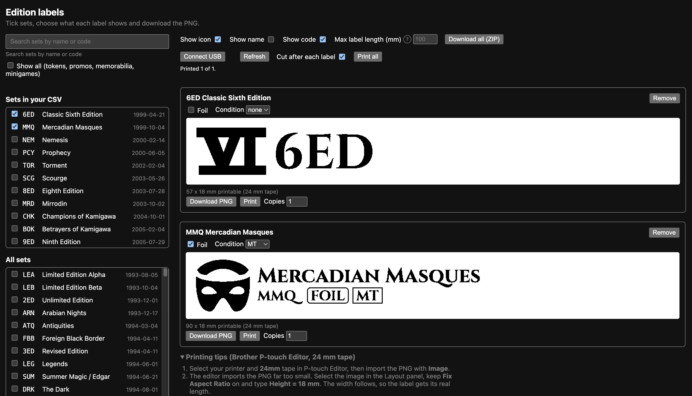

# Listing Assistant for Cardmarket

## Contents

- [Features](#features)
- [Install](#install)
  - [Firefox](#firefox)
  - [Chromium (Chrome, Brave, Edge)](#chromium-chrome-brave-edge)
- [Edition labels](#edition-labels)
  - [Printing](#printing)
- [Privacy](#privacy)
- [Contributing](#contributing)
- [License and disclaimer](#license-and-disclaimer)
- [Documentation](#documentation)

<table>
  <tr>
    <td width="33%" valign="top">
      
      The panel with a loaded ManaBox CSV, above a Cardmarket product page with the pre-filled sell form.
    </td>
    <td width="33%" valign="top">
      
      Edition labels page: pick sets, check the preview, print or download.
    </td>
    <td width="33%" valign="top">
      
      Settings: price source, multiplier, rounding and minimum price.
    </td>
  </tr>
</table>

Browser extension (Manifest V3, plain JavaScript, Firefox and Chromium) that helps to list cards from a ManaBox CSV on Cardmarket, one card at a time.

1. Load one or more ManaBox CSV exports (list or collection) in the panel under the top search bar of any Cardmarket Magic page.
2. Click **Search** on a card. The plugin opens its product page, filtered to the card's language, condition (as minimum) and foil state; your other saved Cardmarket filters stay as they are.
3. The plugin fills the Sell tab (quantity, language, condition, foil, signed, altered, comment) and a price, by default the median of the offers shown for that filter.
4. You check the offers and press "Put for sale" yourself. The plugin never submits anything.
5. The row is marked as listed when Cardmarket confirms the listing. Every loaded CSV keeps its own listed flags.

Cards are identified by the Scryfall ID in the ManaBox CSV, which Scryfall maps to the Cardmarket product ID, so there is no name matching.

## Features

- **Panel under the search bar** on every Magic page on Cardmarket; collapsible, remembers its state.
- **Several ManaBox CSVs**, list or collection exports, each kept separately with a file selector; a binder selector for collection exports.
- **Drag and drop** CSV files onto the panel (the panel fades and shows a hint; other file types are refused), or use "Load ManaBox CSV".
- **Sortable table**: click a column header to sort ascending, descending, or back to CSV order. The `#` column sorts by scanned order (ManaBox's `Added` time).
- **Exact card match** through the Scryfall ID in the CSV (Scryfall gives the Cardmarket product ID); cached.
- **Search button** opens the product page filtered to the card's language, minimum condition and foil state, on top of your saved Cardmarket filter.
- **Sell form pre-filled**: quantity, language, condition, foil, signed, altered, comment ("Misprint" optional) and price.
- **Price from the live market**: median or lowest of the offers shown for that filter, or none; multiplier, rounding and minimum price in the settings.
- **Click an offer price** in the offers table to copy it into the sell form's price field.
- **Filter changes keep your form**: the Cardmarket filter button reloads the page, the plugin puts the sell form values back (an auto-filled price is recomputed for the new filter, a price you entered is kept).
- **Condition and language follow the filter**: changing them in the sell form applies them to the offers filter. The page scrolls to the card title after a search or filter reload.
- **Stay logged in (optional, off by default)**: Cardmarket logs you out after 1 hour without activity. When enabled in the settings, an open Cardmarket tab loads one Cardmarket page every 30 minutes while you are logged in. No password is stored.
- **Listed tracking per loaded CSV**, marks a card "listed" after Cardmarket's success message; manual "done" and "undo" per row.
- **Nothing is submitted for you** and nothing leaves the browser except Scryfall IDs sent to `api.scryfall.com`.

_Why Scryfall: the ManaBox CSV has no Cardmarket product ID, but every Scryfall card record includes it (`cardmarket_id`). The plugin sends only the Scryfall IDs from your CSV (up to 75 per request, once per card, then cached) and reads back the product ID._

## Install

### Firefox

Install it from [Firefox Add-ons](https://addons.mozilla.org/addon/listing-assistant-cardmarket/).

To run it from source instead (for example to try an unreleased change), Firefox 140 or newer loads it as a temporary add-on:

1. Download the source zip from the [releases page](https://github.com/BenRoe/listing-assistant-for-cardmarket/releases/latest) and unzip it into a folder, or clone this repository.
2. Type `about:debugging` in the address bar and click "This Firefox" in the left sidebar.
3. Click "Load Temporary Add-on...", go into the folder and pick the file `manifest.json`.
4. Open a Cardmarket Magic page. The panel appears under the top search bar.

A temporary add-on is removed when you close Firefox, so repeat steps 2 and 3 after each restart. Use the [Firefox Add-ons](https://addons.mozilla.org/addon/listing-assistant-cardmarket/) version for a permanent install. While it is loaded, "Reload" next to the add-on in `about:debugging` applies your edits to the files.

### Chromium (Chrome, Brave, Edge)

The extension is not published on the Chrome Web Store, because Google charges a one-time 5 USD developer registration fee. Install it by hand, it takes a minute. Tested in Chromium only.

1. Download the zip from the [releases page](https://github.com/BenRoe/listing-assistant-for-cardmarket/releases/latest) and unzip it into a folder (or clone this repository).
2. Open `chrome://extensions` (Brave: `brave://extensions`, Edge: `edge://extensions`) and turn on developer mode.
3. Click "Load unpacked" and pick that folder.

## Edition labels

The panel has an **Edition labels** button. It opens a page where you pick sets from the loaded CSV, search the Scryfall set list, or preselect sets with `labels.html#sets=ons,dom`. Each label can show the Keyrune set icon, the set name, the set code, a FOIL mark and a Cardmarket condition code (never a quantity). The preview is exact. Export a PNG for 24 mm tape (128 dots high, 180 dpi), one at a time or all as one ZIP.

### Printing

Verified on a Brother PT-P710BT with 24 mm tape in P-touch Editor (Mac). The editor ignores the PNG's 180 dpi tag and imports it far too small. Select the image, keep **Fix Aspect Ratio** on and type **Height = 18 mm** in the Layout panel; the width follows (about 100 mm for a long label). Set **Y** to 3 mm, leave **Set Length** off and use the smallest **Margin** you accept (the same tips are shown under the label cards). "Max label length (mm)" on the page limits the width; long names then break into lines and shrink to fit.

### Direct print

On Brave, Chrome or Edge you can print to a Brother PT-P710BT over USB without P-touch Editor. Quit P-touch Editor and other Brother utilities first, switch the printer on, put in a 24 mm TZe cassette and press **Connect USB**; the browser asks once which device to use. On macOS no driver is needed.

- **Print** per card and **Print all**; **Copies** sets how many labels of each card (direct print only). One job per label, so an error stops the run and the counters show where to resume.
- **Cut after each label** (on by default). With it off, the labels of a batch print about 10 mm apart and the last one stays in the printer: press the printer's power button twice quickly to feed it out and cut it. A single label with cut off feeds out by itself. Laminated TZe tape cannot be torn by hand, use scissors.
- The loaded tape must be 24 mm, otherwise the page says so. Printer conditions (no tape, cover open, printer busy or off) are shown as sentences with a grey line of raw bytes you can paste into a bug report.
- Margins: about 6 mm of blank tape at each end with cut on. With cut off the first label starts after about 25 mm of tape (the distance from print head to cutter).
- Bluetooth is not offered: it did not work on macOS (`SDP query timeout`). See [docs/label-printing.md](docs/label-printing.md).
- Firefox has no WebUSB, so **Connect USB** is disabled there with a reason; PNG and ZIP export work. Results per browser: [docs/label-printing.md](docs/label-printing.md).
- No extra extension permission is used; the browser asks per device.

## Privacy

- **No telemetry, no analytics, no tracking, no accounts.** The plugin collects nothing about you.
- **The only external requests** go to `api.scryfall.com`: the Scryfall IDs of your CSV cards, to look up Cardmarket product IDs, and, when you open the Edition labels page, one `GET https://api.scryfall.com/sets` for the public set list (cached for 24 hours). Like any web request they expose your IP address to Scryfall. Nothing else is sent: not your prices, quantities, conditions, file names or Cardmarket account data.
- **Everything else stays in your browser**: the loaded CSVs, the ID cache, listed flags, settings and panel state live in the extension's local storage (`storage.local`, not synced to any account). The Cardmarket tab's `sessionStorage` holds a timestamp to detect a finished listing (no card data) and, for a few seconds around a filter reload, the sell form's values (quantity, language, condition, flags, comment, price); both are removed again and vanish with the tab.
- On Cardmarket the plugin only reads the page you have open and fills the form fields; the product pages it opens are normal page loads in your own tab. It never submits a listing for you. With the optional "Stay logged in" setting, an open tab also requests one Cardmarket page (`/<lang>/Magic`) every 30 minutes, the same as a reload; the response is discarded.
- The Edition labels page keeps its preferences and the cached public set list in its own `localStorage` (no CSV data, card names, quantities or prices). Set codes in the `#sets=` URL fragment are never sent to any server. PNG and ZIP files are made in the page and never uploaded.
- Delete data with "Remove CSV" in the panel, "Clear listed flags" and "Clear Cardmarket ID cache" on the options page, or by removing the extension.

## Contributing

- **Bug reports:** open a GitHub issue with the title prefix `[Bug]`, for example `[Bug] Price not filled for foil cards`.
- **Questions:** open a GitHub issue with the title prefix `[QA]`.
- **Feature requests:** open a GitHub issue with the title prefix `[Feature]`, for example `[Feature] Remember the last used binder`.
- **Fixes:** pull requests that fix a bug are welcome. Run `node --test test/shared.test.mjs test/labels.test.mjs test/labels-static.test.mjs test/ptouch.test.mjs test/printer.test.mjs test/transport.test.mjs` before you open one.
- **New features:** please discuss them in a `[Feature]` issue first. A pull request for a feature that was not agreed in an issue may be closed.

## License and disclaimer

MIT, see [LICENSE](LICENSE). Bundled: [Papa Parse](https://github.com/mholt/PapaParse) v5.0.2 (MIT), unmodified, in `lib/papaparse.min.js`. [Keyrune](https://github.com/andrewgioia/keyrune) (set icons) v3.19.0 in `labels/lib/keyrune/`: font files SIL OFL-1.1, glyphs and code GPL-3.0, with its licence text; the symbols are trademarks of Wizards of the Coast. Cinzel Bold (label text) in `labels/lib/cinzel/`: SIL OFL-1.1, with its licence and FONTLOG.

Not affiliated with, endorsed by or sponsored by Cardmarket, ManaBox or Scryfall. All names are trademarks of their owners. Magic: The Gathering, its names and set symbols are trademarks of Wizards of the Coast; this project is not affiliated with them.

The privacy policy is also in [PRIVACY.md](PRIVACY.md).

## Documentation

Research notes and design are in [.docs/readme.md](.docs/readme.md).
